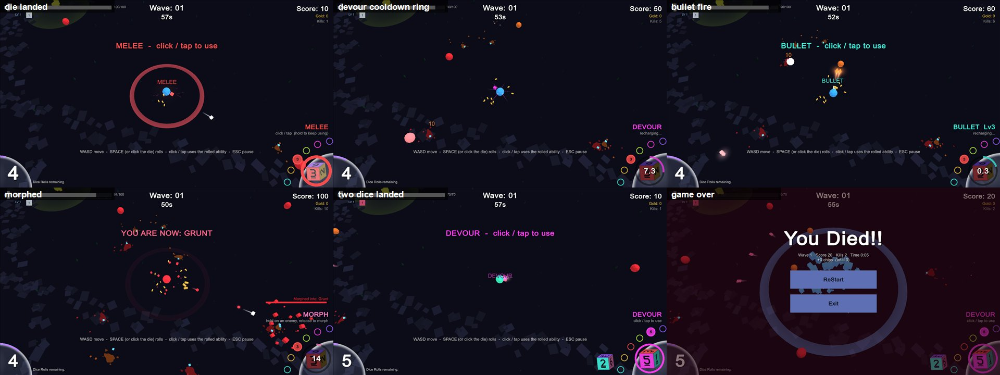

# Dice Mania: Survivors (prototype)
A fusion of Vampire Survivors, dice rolls and bullet hell — the sequel to the PP Jam #8 game *Dice Mania*.

**Unity 6.6 (6000.6.2f1) · Entities (ECS) + Burst · Web (WebGL2)** · basic-shape prototype (visual pass comes later).

## Open & play
1. Open this folder in Unity Hub with **6000.6.2f1**. First import creates `Assets/_Game/Scenes/Main.unity` (or run `Dice Mania → Setup Project`).
2. Press **Play** in any scene — the game boots itself (`Bootstrap.cs`), no scene setup needed.
3. Web build: `Dice Mania → Build Web` → `Builds/Web` (or CLI: `-executeMethod DiceMania.EditorTools.WebBuild.BuildWeb`).
   Windows playtest build: `Dice Mania → Build Windows (playtest)` → `Builds/Win/DiceMania.exe` (CLI: `...WebBuild.BuildWindows`).

## Controls
WASD move · weapons auto-fire · **SPACE** (or click the die, bottom right) rolls · the rolled face is your ability:
**click to use it** at the cursor, then it recharges (ring around the die) · Morph: hold on an enemy, release · 1/2/3 pick level-up card ·
ESC pause · ENTER confirm · F5 (Editor) hot-reload data.
Default die: 1 Bullet · 2 Duplicate · 3 Melee · 4 Heal · 5 Devour · 6 Refresh (refills rolls; Morph on the Mimic).
Touch: left thumb = joystick, tap anywhere else = use the ability there, tap a corner circle = roll.
Gamepad: left stick move · A / RB roll · RT (+ right stick) uses / aims the ability · D-pad picks cards · Start pause / continue.
Pause menu: sound, **screen shake** and **rumble** toggles.

## HUD
Laid out like the itch original: white "+" HP bar, `Wave: 01` + countdown, `Score:`, rolls in the bottom-left glass circle,
and the 3D die bottom right with the face fan and the ability cooldown ring (screenshots from the build's `-hudshots` mode):

## Game feel
Hit flash + squash + slight knockback, gun kick / muzzle flash / recoil / camera kick, shells and splats that stay on the floor,
kills that freeze then get thrown, hit-stop, damage numbers that pop, ability VFX (ice spikes, meteors, shockwaves…).
Research and the full mapping: [docs/04_GAME_FEEL.md](docs/04_GAME_FEEL.md). Every knob is in the CSV sheets.

## Tests
- EditMode: dice logic, CSV parsing, sheet validation, spreadsheet round trip (xlsx ↔ CSV, incl. files saved by Excel).
- PlayMode (`Assets/_Game/Tests/PlayMode`): a bot plays several waves (dice, abilities, Morph, level-ups, Forge, pause, death), a boss wave,
  click-to-use abilities with cooldowns, and a gallery that fires every dice face. Captures go to `Builds/Captures` (or `$DICEMANIA_CAPTURE_DIR`).
- CLI: `Unity -batchmode -projectPath . -runTests -testPlatform PlayMode -testResults results.xml`
- Build UI check: `Builds/Win/DiceMania.exe -hudshots <folder>` plays a short scripted run (roll, abilities, cooldown ring,
  Morph, two dice, death), saves HUD screenshots and quits; it uses its own save slot.

## Edit the game without code
Every ability, upgrade, enemy, wave and stat is in the spreadsheet **[`DiceMania_Data.xlsx`](DiceMania_Data.xlsx)** (one tab per sheet;
`Dice Mania → Data → Open Spreadsheet`). Save it with Unity open and the game data (`Assets/_Game/Resources/Data/*.csv`) updates,
live in Play mode → see [docs/03_DATA_SHEETS.md](docs/03_DATA_SHEETS.md).

## Docs
- [01 Original game analysis](docs/01_ORIGINAL_GAME_ANALYSIS.md)
- [02 Design & technical plan](docs/02_DESIGN_AND_TECH_PLAN.md)
- [03 Data sheets](docs/03_DATA_SHEETS.md)
- [04 Game feel](docs/04_GAME_FEEL.md)

## Code map (`Assets/_Game/Runtime`)
| Folder | |
|---|---|
| `Data/` | CSV reader + typed definitions (`GameDatabase`) |
| `ECS/` | Components and Burst systems: Player, Weapon, Enemy, Motion, Combat (spatial hash) |
| `Presentation/` | Procedural meshes, `InstancedRenderSystem` (RenderMeshInstanced, WebGL2-safe), camera, procedural SFX, `DiceView` (the 3D HUD dice) |
| `Game/` | `GameDirector` (state machine, waves, dice, abilities + cooldowns, Morph, level-ups, Dice Forge), run state, meta save, ECS bridge |
| `UI/` | IMGUI HUD laid out like the original (HP bar, wave timer, score, rolls corner, die corner with the cooldown ring), menus |

Editor (`Assets/_Game/Editor`): `DataWorkbook` + `SheetIO` (the spreadsheet sync), builds, project setup.
