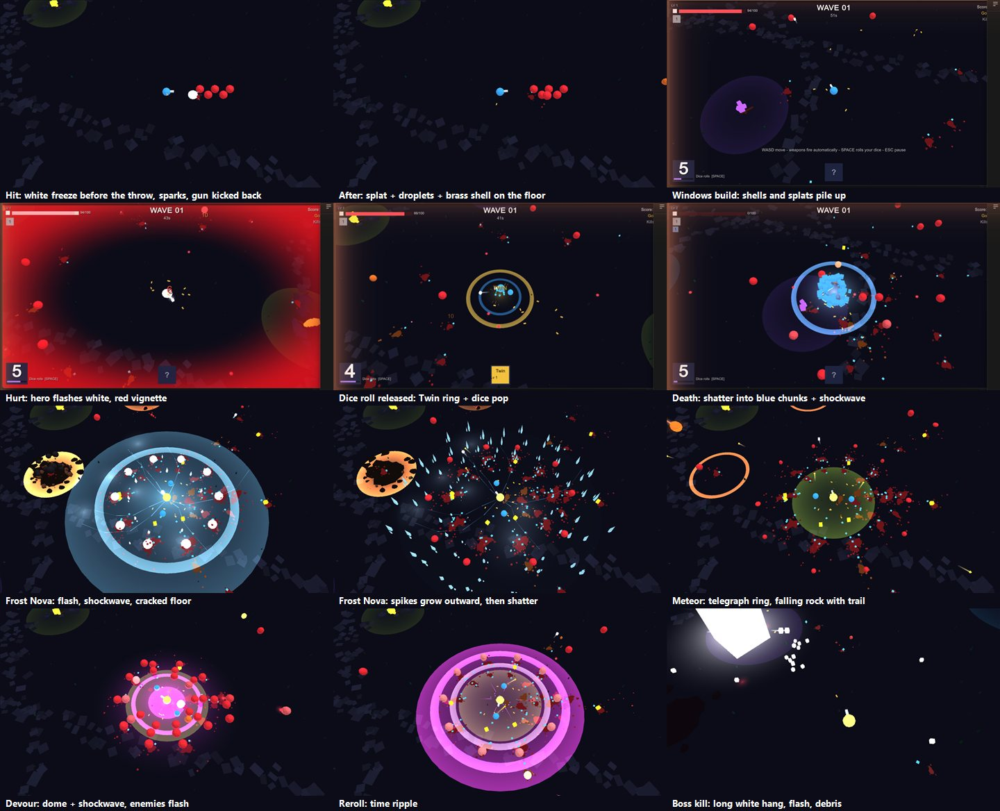

# Game feel ("juice") pass

Goal: every shot, hit and kill should feel punchy and readable, even with hundreds of enemies on screen.
This doc lists the principles we followed, where they came from, and where each one lives in the code / data.

## 1. Owner's brief
1. **Hits:** flash the enemy white, squash it, knock it back slightly.
2. **Guns:** recoil — push the hero back and kick the camera with a vibration so the player feels it.
3. **Damage effects:** damage numbers, bullet shells, and special effects for the special abilities (dice faces).
4. **Killing blow:** freeze the body for a beat, then throw it.

## 2. Research: [vasilev.yegor](https://www.instagram.com/vasilev.yegor/) (Instagram "make X juicy" reels)
Each reel layers one effect up step by step on a simple capsule hero and enemy. Summary (in our words) of what we took
from the ones we studied:

| Reel | Techniques we used |
|---|---|
| [Gunfire](https://www.instagram.com/vasilev.yegor/reel/Dehz2z9Nc7F/) | Animate the gun on every shot (kick + muzzle flash); vary the bullets (spread, trails, sparks) so a stream doesn't read as one beam; hit reaction on the enemy (white flash, squash, small shove); recoil on the shooter and the camera; leave shells and splats on the floor; short sounds with random pitch; give the killing blow extra weight (a pause, then the body flies) |
| [Hits](https://www.instagram.com/vasilev.yegor/reel/DecdQ9ltnjf/) | White flash, impact sound on the hit frame, particles, knockback, a little shake plus a few frozen frames, a satisfying pop on death |
| [Magic attack](https://www.instagram.com/vasilev.yegor/reel/Deff1_AtlFi/) | Charge before the cast, bright core, trail, impact burst, target reaction, sound, a lingering after-effect, bigger crit numbers, a death that matches the element |
| [Ice spikes](https://www.instagram.com/vasilev.yegor/reel/DetoueoNkIr/) | A field of spikes instead of one, spikes getting bigger further out, small side spikes, cracked floor, a big final cluster, shattering, mist |
| [Lightning](https://www.instagram.com/vasilev.yegor/reel/DeaiBSlodi2/) | Jagged path with exaggerated corners, thicker at the bends, glow layered from wide/soft to narrow/bright, tapered ends, white-hot core (used for the Frost Nova floor cracks) |
| [Anime hits](https://www.instagram.com/vasilev.yegor/reel/Deidw81hnmg/) | Freeze, white silhouette, colour inversion, radial speed lines, a hard zoom-in that snaps back |
| [Cartoon rules](https://www.instagram.com/vasilev.yegor/reel/DejpGOctoHu/) | Classic animation principles applied to effects: anticipation, squash and stretch, follow-through, hold the impact a few frames, arcs |
| [Chests](https://www.instagram.com/vasilev.yegor/reel/Deo9lu7tzCT/) | Build-up wobble, a squash, light, popping stars on open |

A viewer's point under the gunfire reel matched our own worry: heavy knockback from *bullets* makes them feel soft, as if they
bounce enemies around instead of passing through. So bullets get a **slight** shove; heavy weapons and explosions get the big one.

## 3. How it maps onto Dice Mania
| Principle | In the game |
|---|---|
| Flash white | `Visual.Flash` — crisp full-white frame, then a fast fade (InstancedRenderSystem) |
| Squash | `Visual.SquashAmp/SquashT` — damped jelly wobble on hit, on the hero when hurt, on thrown corpses |
| Slight knockback | `Projectile.Knockback` per weapon (Weapons.csv). Bullets small, Cannon/explosions large, bosses barely move |
| Gun kick + muzzle flash | The hero carries a small gun that aims at the target, kicks back and flashes on every shot; muzzle glow + sparks |
| Bullet variety | Small random spread on Pip Shot, glowing trails (`VisualFx.Trail`) on every player bullet, impact sparks |
| Recoil | Hero pushed back opposite the shot (`Recoil` column), camera kicked opposite the shot (`Kick`) + a short vibration (`Shake`) + gamepad rumble |
| Shells / splats | Brass shells eject, bounce, clink and stay on the floor (`Shell` column, `ShellLife`); enemy-coloured splats + droplets stay (`SplatLife`) |
| Sound | Procedural layered SFX (snap, thud, ping, pop, boom, shatter) with random pitch on every play; music pitches down in slow motion |
| Kill pause + throw | Killed enemies hang white for `CorpseFreeze` s, then fly along the killing hit (`CorpseThrow`), bounce and pop into cubes |
| Weighty killing blow | Kill numbers are bigger, kill sparks, tiny global hit-stop on sparse kills (`HitStopKill`, rate-limited by `HitStopCooldown` and skipped in hordes so it never stutters); elites/bosses freeze longer |
| Damage numbers | Pop in large, arc up and fall; crits yellow with "!", killing blows orange |
| Charge → burst | Rolling the dice pulls streaks into the hero during the tumble, then the face fires with a ring + flash in its colour |
| Ice spikes | Frost Nova: rings of spikes that grow outward, cracked floor, mist, spikes shatter |
| Meteor | A rock falls on the telegraph ring, then flash + shockwave + embers + scorch mark |
| Anime hit | Copy hit and boss kills: freeze, white flash, burst lines, camera punch-in |
| Chest | Chests wobble faster as you approach, with a glow; opening one bursts out popping stars |
| Readability | Enemies brighten just before they fire; enemy bullets get a soft red halo; hurt = red vignette + HP bar ghost; low HP pulses |

All feel knobs are data: `Config.csv` (`HitStop*`, `Corpse*`, `SplatLife`, `ShellLife`, `ScreenShake`, `CameraKick`,
`Recoil`, `Rumble`, `DamageNumbers`) and the per-weapon `Recoil / Kick / Shake / Shell` columns in `Weapons.csv`.
Players can turn screen shake, rumble and music off in the pause menu.
